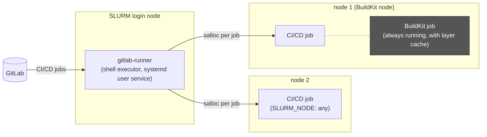
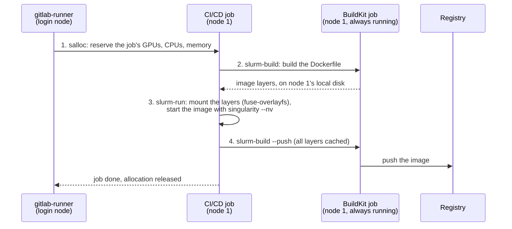

# slurm-gpu-for-gitlab-ci

GitLab CI/CD on a SLURM cluster: build Docker images and run them on GPUs,
as an ordinary user -- no root, no Docker daemon.



```yaml
# .gitlab-ci.yml
ship:
  tags: [slurm]
  variables:
    SLURM_GPUS: "1"
  script:
    - slurm-build          # build the Dockerfile on BuildKit, cache warm
    - slurm-run            # run the image on a GPU (singularity --nv)
    - slurm-build --push   # push to the project's registry
```

A code-only change builds and runs in about 10 seconds.

## How it works

One CI/CD job, step by step -- each step starts when the one before it is
done:



More tools for jobs (`slurm-sif`, `slurm-cache`, `package`,
`slurm-monitor`, `slurm-service`, `slurm-job-local`):
[docs/consumer-api.md](docs/consumer-api.md).

## Requirements

The BuildKit node needs **user namespaces, a subuid/subgid range for your
user, FUSE and Linux ≥ 5.11**. These are often off on HPC clusters. On the
cluster this was built on, the admins had to grant some of them first:
[docs/admin-requirements.md](docs/admin-requirements.md).

## Without enough privileges: kaniko and buildah

For a notebook or IDE container (JupyterHub, Coder, ...) with no container
daemon and no user namespaces, but with `sudo`, [`builders/`](builders) has
`kaniko-build` and `buildah-build`
([kaniko](docs/builders/kaniko.md), [buildah](docs/builders/buildah.md)).
Install with `bootstrap/install.sh restricted-pod`.

## License

[GPL-3.0](LICENSE). The buildah patches in `builders/buildah/` modify
[buildah](https://github.com/containers/buildah) (Apache-2.0).
